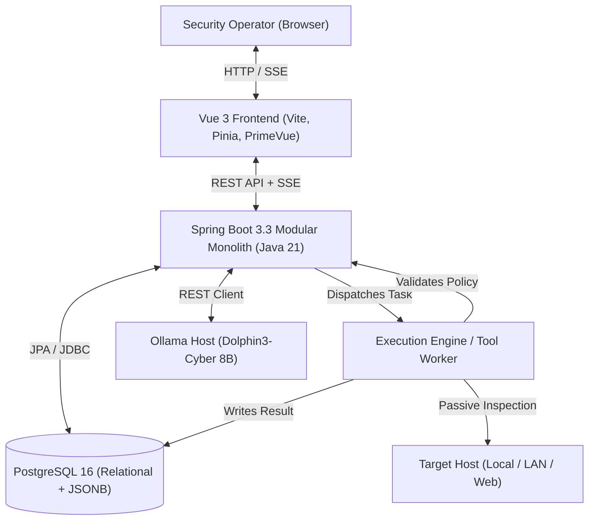
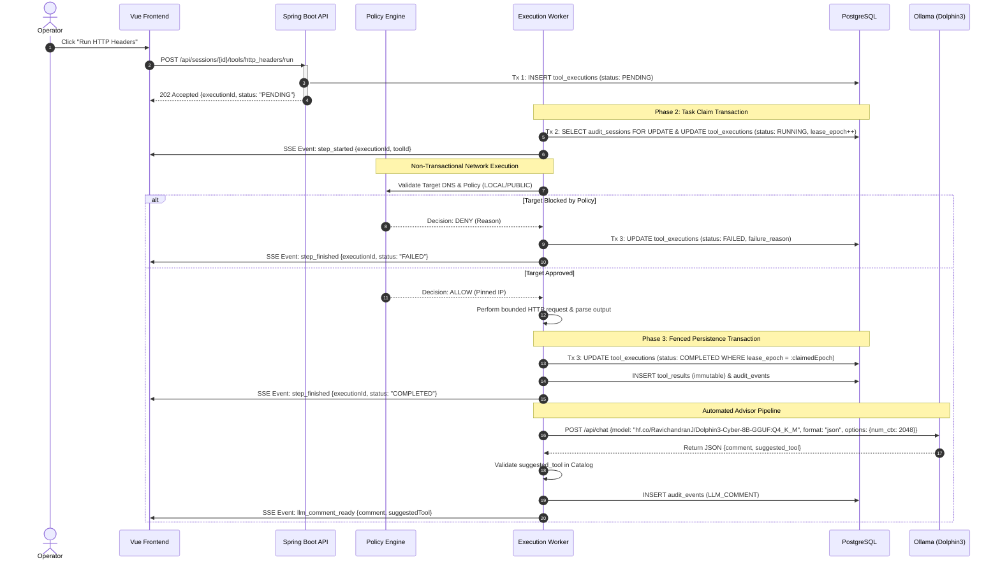

# 02. Architecture Specification

## Overview
Ospysin is designed as a **modular monolith** running locally on the operator's machine. The architecture isolates user interactions, deterministic tool execution, network safety policies, and local LLM advisory into distinct domains while avoiding the operational friction of distributed microservices.

---

## High-Level Architecture Diagram



---

## Component Responsibilities

| Component | Technology | Primary Responsibilities |
| :--- | :--- | :--- |
| **Frontend UI** | Vue 3, TypeScript 5, Vite, Pinia, PrimeVue | Renders 4-panel workspace, presents real-time SSE execution logs, displays raw and parsed payloads, captures user tool triggers. |
| **Backend Core** | Spring Boot 3.3.x, Java 21 | Enforces authentication, validates sessions, coordinates transactions, provides REST APIs, serves Server-Sent Events (SSE). |
| **Policy Engine** | Java 21 (In-Memory Module) | Performs SSRF checks, validates IP allowlists/denylists, enforces timeout budgets and payload size limits prior to any network connection. |
| **Tool Execution Engine** | Java 21, Apache HttpClient / Custom Sockets | Executes passive scanning tools deterministically, normalizes headers/DNS/TLS payloads, generates structured JSON representations. |
| **LLM Client** | Spring RestClient | Interfaces with Ollama over HTTP, transmits constrained context prompts, validates received tool recommendations against catalog. |
| **Storage Engine** | PostgreSQL 16, Flyway | Stores relational domain entities (Users, Projects, Sessions, Findings) and append-only tool execution records using JSONB. |

---

## Technology Stack

- **Runtime**: Java 21 (OpenJDK / Eclipse Temurin LTS).
- **Backend Framework**: Spring Boot 3.3.x (`spring-boot-starter-web`, `data-jpa`, `security`, `validation`, `actuator`).
- **Database & Migration**: PostgreSQL 16, Flyway 10.x.
- **Frontend Stack**: Vue 3 (Composition API, `<script setup>`), TypeScript 5.4, Vite 5, Pinia 2.1, PrimeVue 3.5.
- **LLM Runtime**: Ollama (Local runtime hosting `hf.co/RavichandranJ/Dolphin3-Cyber-8B-GGUF:Q4_K_M` via GGUF format).
- **Networking & Parsers**: Java `HttpClient`, `dnsjava`, `jsoup`, custom SSL socket inspectors.
- **Containerization**: Docker 26.x, Docker Compose v2.

---

## Data Flow: End-to-End Tool Execution

1. **User Action & Enqueue (Phase 1 Ingestion Tx)**: The operator triggers a tool (e.g. `Run HTTP Headers`). The API validates that the session is `ACTIVE`, checks that no duplicate job is already queued/running, commits a new `tool_executions` record with `status = PENDING`, logs an audit event, and immediately returns `202 Accepted` with the execution ID and status.
2. **Task Claim & Lease (Phase 2 Worker Claim Tx)**: A background worker thread claims the task under a session row-lock (`SELECT id FROM audit_sessions WHERE id = :sessionId FOR UPDATE`). It verifies no other execution is `RUNNING` for this session, increments `lease_epoch`, sets `status = RUNNING` with an expiration timestamp (`lease_expires_at`), commits, and emits `step_started` across the SSE stream.
3. **Policy Evaluation & Socket Execution (Non-Transactional Phase)**: Outside any database transaction, the worker resolves target DNS via `getAllByName`, validates all resolved IPs against authoritative registries via `PolicyEngine`, pins the safe IP, and executes the bounded inspection over the wire with timeouts and payload caps.
4. **Persistence & Fencing Guard (Phase 3 Persistence Tx)**: The worker parses the response into normalized JSON and enters a persistence transaction. Using a monotonic fencing token (`WHERE id = :id AND lease_epoch = :claimedEpoch AND session.state = 'ACTIVE'`), it records immutable `tool_results`, extracts `observations`, marks `tool_executions` as `COMPLETED`, logs `audit_events`, and commits.
5. **SSE Broadcast**: The backend publishes a `step_finished` event across the SSE stream, instantly updating the frontend result viewer.
6. **Automated Advisory Pipeline**: Upon successful completion, the backend queues an asynchronous advisory task to Ollama (`hf.co/RavichandranJ/Dolphin3-Cyber-8B-GGUF:Q4_K_M`), validates the model output against the catalog, records the recommendation in `audit_events`, and emits `llm_comment_ready` over SSE.

---

## Why Modular Monolith for v1

1. **Zero Distributed Systems Overhead**: Microservices introduce distributed transactions, network latency between services, deployment complexity, and RPC serialization overhead without any benefit for a single-operator local application.
2. **Strict In-Process Policy Guarantees**: Enforcing SSRF, rate limiting, and DNS rebinding protections directly within the backend memory space eliminates the risk of bypasses caused by network hops.
3. **Decoupled Transaction Boundaries**: Database transactions are kept strictly bounded to short-lived state changes (Phase 1 enqueue, Phase 2 claim, Phase 3 persistence). Remote network sockets and LLM inference calls execute strictly outside database transactions, preventing HikariCP pool exhaustion.
4. **Clean Domain Boundaries**: Modules are organized into cleanly decoupled packages (`com.ospysin.{identity,projects,engagements,scope,sessions,tools,policy,execution,observations,findings,evidence,reporting,llm,shared}`). If horizontal scaling or separated workers become necessary in future releases, modules can be extracted cleanly.

---

## Local Development Topology

```text
Host Operating System (Windows / Linux / macOS)
├── Ollama Service (:11434) [Native Host GPU/CPU Acceleration]
└── Docker Compose Network (ospysin-net)
    ├── PostgreSQL Container (:5432) [Loopback published or internal-only]
    ├── Backend Container (:8080) -> communicates with host:11434 via host.docker.internal
    └── Frontend Container (:5173) -> proxies API calls to Backend
```

---

## Sequence Diagram: Asynchronous Tool Execution


