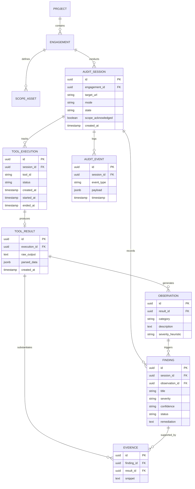

# 03. Domain Model Specification

## Overview
This document defines the core business entities, relationships, invariants, and lifecycle transitions of Ospysin. The domain model enforces forensic accountability, strict immutability of raw execution artifacts, and clear separation between raw observations and human-confirmed findings.

---

## Domain Entities & Specifications

### 1. User
- **Purpose**: Represents the local operator conducting the audits.
- **Key Fields**: `id` (UUID), `username` (String), `role` (ADMIN | AUDITOR), `created_at` (Timestamp).
- **Invariants**: For v1 single-user deployment, an administrative operator is initialized on first boot.

### 2. Project
- **Purpose**: Top-level container grouping related audit targets and engagements (e.g., "Internal CRM", "Public Marketing Infrastructure").
- **Key Fields**: `id` (UUID), `name` (String), `description` (Text), `created_at` (Timestamp), `updated_at` (Timestamp).
- **Relationships**: One Project has many Engagements.
- **Invariants**: On initial boot, a default system container ("Default Project") is provisioned to host managed ad-hoc engagements and sessions.

### 3. Engagement
- **Purpose**: A formal assessment authorization window with an explicitly defined scope and time boundary.
- **Key Fields**: `id` (UUID), `project_id` (UUID), `title` (String), `start_date` (Date), `end_date` (Date), `status` (DRAFT | ACTIVE | COMPLETED | ARCHIVED).
- **Relationships**: Belongs to a Project (ON DELETE RESTRICT); has many ScopeAssets and AuditSessions.

### 4. ScopeAsset
- **Purpose**: An approved URL, domain, or IP address authorized for inspection within an Engagement.
- **Key Fields**: `id` (UUID), `engagement_id` (UUID), `asset_type` (URL | FQDN | IP), `value` (String), `is_wildcard` (Boolean).
- **Invariants**: Tool execution against any target must match at least one approved ScopeAsset. In v1, ad-hoc sessions automatically instantiate a managed Engagement under the Default Project and a single bounded ScopeAsset locked to the target host. **Scope NEVER expands automatically or dynamically** based on discovered third-party URLs or assets. Probing any external host requires initiating a separate audit session.

### 5. AuditSession
- **Purpose**: An interactive auditing session focused on a specific target URL.
- **Key Fields**:
  - `id` (UUID)
  - `engagement_id` (UUID, mandatory)
  - `target_url` (String)
  - `mode` (LOCAL | PUBLIC)
  - `state` (ACTIVE | COMPLETED | ABORTED)
  - `scope_acknowledged` (Boolean)
  - `scope_ack_version` (String, e.g. "1.0.0")
  - `scope_ack_text` (Text)
  - `scope_ack_hash` (String, SHA-256 hex digest of canonical server legal text)
  - `scope_ack_timestamp` (Timestamp)
  - `created_at` (Timestamp)
  - `updated_at` (Timestamp)
- **Lifecycle States**:
  - `ACTIVE`: Initial operational state created upon operator scope confirmation; tools can be queued and triggered.
  - `COMPLETED`: Operator finalized review; all tools must be completed (rejects if executions are running/pending).
  - `ABORTED`: Terminated early; cancels running sockets without persisting partial output to `tool_results`, and transitions pending tools to `CANCELLED`.
- **Invariants**: No tool execution can occur unless `scope_acknowledged == true`, `scope_ack_hash != null`, and `state == ACTIVE`. Every generated report references `scope_ack_hash`.

### 6. ToolExecution
- **Purpose**: Represents a single invocation of an inspection tool within an AuditSession.
- **Key Fields**: `id` (UUID), `session_id` (UUID), `tool_id` (String), `status` (PENDING | RUNNING | COMPLETED | FAILED | CANCELLED), `input_params` (JSONB / Map), `lease_owner` (UUID), `lease_epoch` (Integer), `lease_expires_at` (Timestamp), `attempts` (Integer), `failure_reason` (String), `created_at` (Timestamp), `started_at` (Timestamp, optional), `ended_at` (Timestamp), `duration_ms` (Long).
- **Invariants**: `tool_id` must reference a valid, registered identifier from the static Tool Catalog. Exactly one `ToolResult` is produced per successful execution. At most one execution per session can be `RUNNING` at any moment.

### 7. ToolResult
- **Purpose**: The immutable payload generated by a ToolExecution.
- **Key Fields**: `id` (UUID), `execution_id` (UUID), `raw_output` (Text), `parsed_data` (JSONB), `score` (Integer, optional), `has_errors` (Boolean), `created_at` (Timestamp).
- **Invariants**: **Strictly immutable**. Once persisted, record cannot be modified or deleted via application repositories or direct SQL triggers.

### 8. Observation
- **Purpose**: An automated, factual insight extracted from parsed tool results (e.g., "Missing HSTS header", "Exposed /admin in sitemap.xml").
- **Key Fields**: `id` (UUID), `result_id` (UUID), `category` (String), `description` (Text), `severity_heuristic` (INFO | LOW | MEDIUM | HIGH), `detected_at` (Timestamp).
- **Invariants**: Automatically created; distinct from verified security Findings.

### 9. Finding
- **Purpose**: A human-evaluated, verified security risk, vulnerability, or misconfiguration established by the auditor.
- **Key Fields**: `id` (UUID), `session_id` (UUID), `observation_id` (UUID, optional), `title` (String), `description` (Text), `severity` (INFO | LOW | MEDIUM | HIGH | CRITICAL), `confidence` (TENTATIVE | CONFIRMED), `status` (POTENTIAL | UNDER_REVIEW | CONFIRMED | REJECTED | ARCHIVED), `rejection_reason` (Text, mandatory if REJECTED), `remediation` (Text).
- **Invariants**: May reference an Observation (optional) and zero or more Evidence items. Hard deletion is prohibited; false positives transition to `REJECTED` with an auditable `rejection_reason`.

### 10. Evidence
- **Purpose**: A specific excerpt, raw header line, or snippet proving a Finding.
- **Key Fields**: `id` (UUID), `finding_id` (UUID), `result_id` (UUID), `snippet` (Text), `created_at` (Timestamp).
- **Invariants**: Directly traces back to an immutable ToolResult.

### 11. AuditEvent
- **Purpose**: System-wide forensic ledger tracking all actions and policy decisions.
- **Key Fields**: `id` (UUID), `session_id` (UUID), `event_type` (SESSION_STARTED | SESSION_COMPLETED | SESSION_ABORTED | SCOPE_ACKNOWLEDGED | POLICY_EVALUATED | TOOL_TRIGGERED | TOOL_FINISHED | LLM_QUERY | LLM_COMMENT | FINDING_CREATED | FINDING_REJECTED), `payload` (JSONB), `timestamp` (Timestamp).
- **Invariants**: Append-only log. Never updated or purged during standard operations.

---

## Entity Relationship Diagram

